

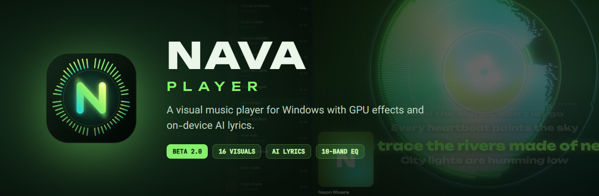

 

**Nava turns your music library into a live light show.** 
16 GPU visuals that dance to the bass and the vocals, synced lyrics written on your own PC by AI, 
a studio-style sound lab, and a design you'll actually want to look at.

[**⬇ Download for Windows**](../../releases) · [Installation guide](docs/INSTALL.md) · [What's new](CHANGELOG.md) · [Report a bug](../../issues/new/choose)

---

## ✨ Highlights

<table>
<tr>
<td width="50%">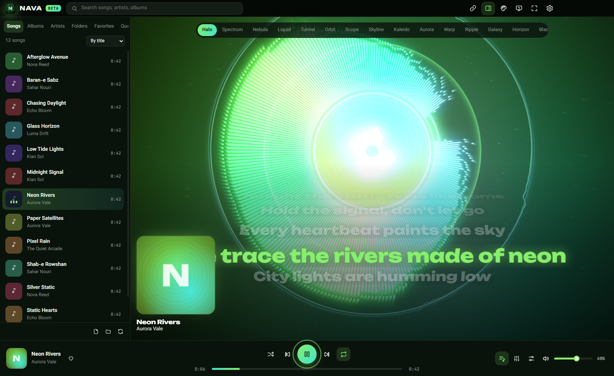</td>
<td width="50%">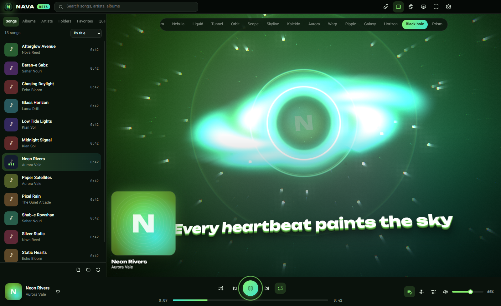</td>
</tr>
<tr>
<td align="center"><b>Halo</b> — a 128-bar ring that reacts to every kick, with the wheel lyrics style</td>
<td align="center"><b>Black hole</b> — accretion disk, gravitational ring and 3D extruded lyrics</td>
</tr>
<tr>
<td width="50%">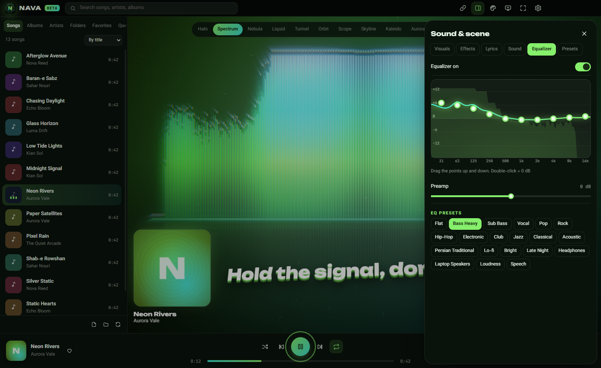</td>
<td width="50%">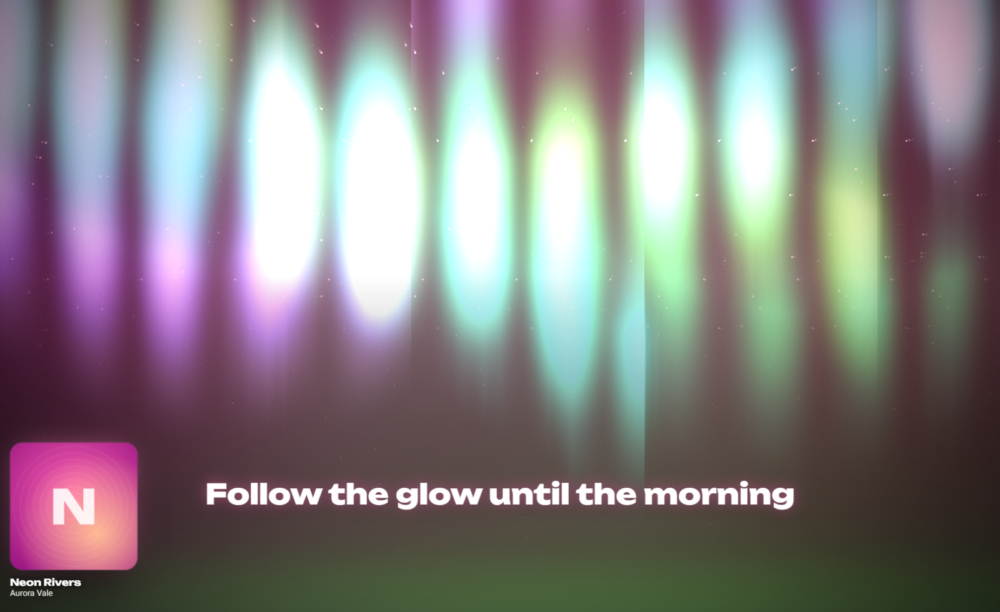</td>
</tr>
<tr>
<td align="center"><b>10-band equalizer</b> — drag the curve, watch the live spectrum underneath</td>
<td align="center"><b>Stage mode</b> — every control disappears; only light and lyrics remain</td>
</tr>
</table>

## 🎧 Features

### Visuals
- **16 real-time GPU visuals**: Halo, Spectrum, Nebula, Liquid, Tunnel, Orbit, Scope, Skyline, Kaleido, Aurora, Warp, Ripple, Galaxy, Horizon, Black hole and Prism.
- Everything renders in **WebGL2 on your graphics card**: bloom, echo trails, warp zoom, beat flash, chromatic shift, film grain and particle systems — while the CPU stays nearly idle.
- Visuals react separately to **bass, mids, vocals and highs**, with automatic beat detection.
- **40 hand-tuned presets** (Night Club, Event Horizon, Sakura Dream, Synthwave, Crystal…), your own saved presets, and auto-switching every 30 s, every minute or every song.
- The album cover can spin like vinyl in the centre of the visual, and a large cover card sits beside the stage.

### AI lyrics — on your own PC
- Nava **writes synced lyrics while the song plays** using OpenAI's Whisper (large-v3 and large-v3-turbo) through whisper.cpp.
- Supports **Persian, English and Russian**, with automatic language detection and a one-click "regenerate as…" menu.
- **Persian gets special care**: the accurate large-v3 model is chosen automatically, instrumental parts are skipped with voice detection (VAD), and the text is cleaned up (Persian letter forms, half-spaces, punctuation).
- Runs on **NVIDIA GPUs with CUDA** (a 4-minute song takes about 15 seconds) or on the CPU.
- **No audio ever leaves your computer.** Lyrics are cached and saved as `.lrc` files — in a folder you choose, or next to each song.
- The next song in the queue is prepared in advance.

### Lyric fonts
- Pick **separate fonts for Persian and for English/Russian lyrics**, plus the font weight, with a live preview.
- **Import your own fonts** (`.ttf`, `.otf`, `.woff`, `.woff2`) from Settings or by dropping the files onto the window. Imported fonts stay on your computer.

### Lyric animations
16 styles, including **four 3D styles**: Wheel · Smooth list · Karaoke · Slide · Soft blur · Word by word · Flying words · Bouncing word · Typewriter · Neon · Cinema subtitles · Page flip · **3D Extrude** · **3D Fly-in** · **3D Cube** · **3D Orbit**

### Sound lab
| | |
|---|---|
| **Equalizer** | 10 bands (31 Hz – 16 kHz), live response curve, preamp, 20 presets |
| **Pitch & speed** | ±12 semitones of pitch independent of tempo, 0.5×–2× speed, vinyl mode |
| **Space** | Reverb with Room / Hall / Cathedral / Plate / Cave / Studio presets |
| **Bass boost** | Up to +15 dB low shelf |
| **8D audio** | Sound circles around your head at an adjustable speed |
| **Stereo** | Width, balance, mono, loudness normalization |
| **Transitions** | Fade in / fade out, sleep timer (15–90 min or end of track) |
| **Volume booster** | Up to **300%** with a limiter, a clear warning before it turns on, and a reminder after 10 minutes above 100% |

### Library & playback
- Scans your Music, Downloads and Desktop folders (or any folder — or every drive), reading titles, artists, albums and cover art.
- Songs, albums, artists, folders, favorites and queue views, instant search, sorting by title, artist, newest, length or play count.
- **Skips tracks shorter than your limit** (30 s by default) during normal playback; they still play when you pick them yourself.
- Shuffle, repeat one/all, play counts, favorites and resume-where-you-left-off.

### Streaming links
- Paste a **Spotify, SoundCloud or YouTube** link and it plays through the service's official player inside Nava, with the visuals following your system audio.
- **Direct audio links and internet radio** play through Nava's full engine, with every effect and the equalizer.

### Made for Windows
- Proper installer with an optional desktop shortcut and registration as a music player, so you can **double-click any song** or pick Nava in *Open with* and *Default apps*.
- **System tray**: Nava asks whether to quit or keep playing in the tray (and can remember your choice). Can also start with Windows.
- **Hotkeys you can rebind**. They only work while Nava is the active window, so pressing keys in a game never affects it. Keyboard and headset media keys are supported too.

### Design
- **English and Persian** interface, with full right-to-left layout.
- **Six themes** — Nava Lime, Daylight, Midnight, **Sakura**, Ember, Glacier — plus a **theme builder** for your own colours.
- An animated loading screen, a short welcome message on launch (20 rotating messages per language), a goodbye message on exit, a first-run setup and a **guided tour** for new users.

<table>
<tr>
<td width="33%">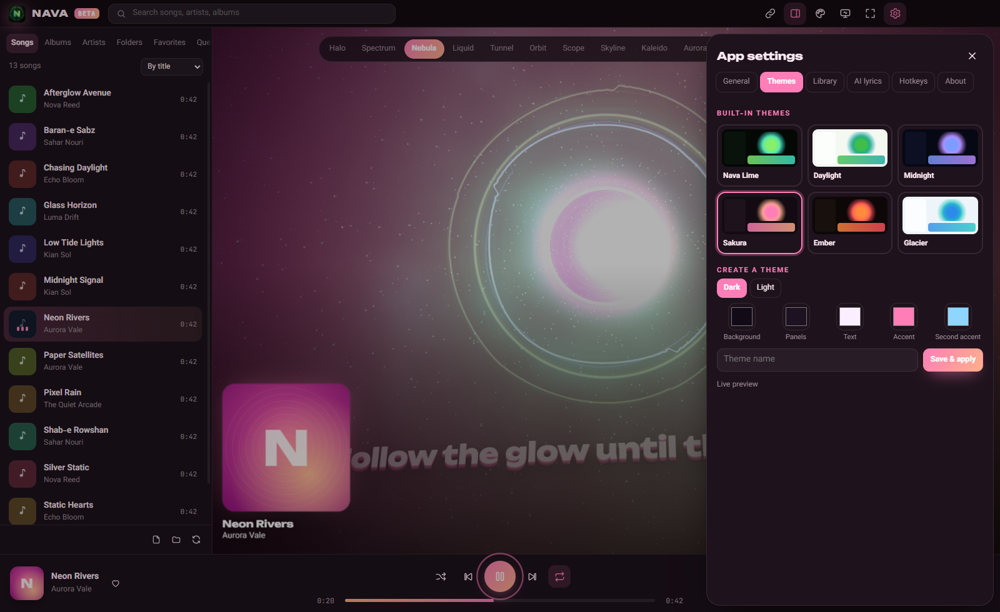</td>
<td width="33%">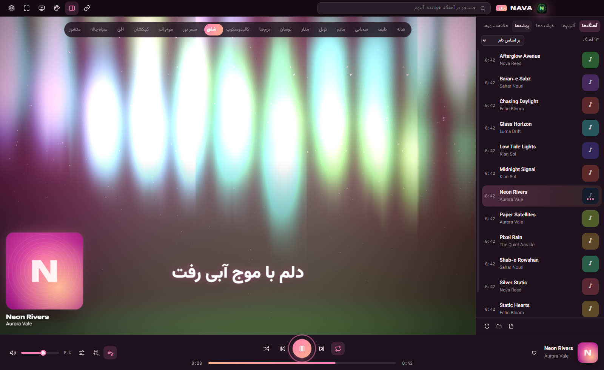</td>
<td width="33%">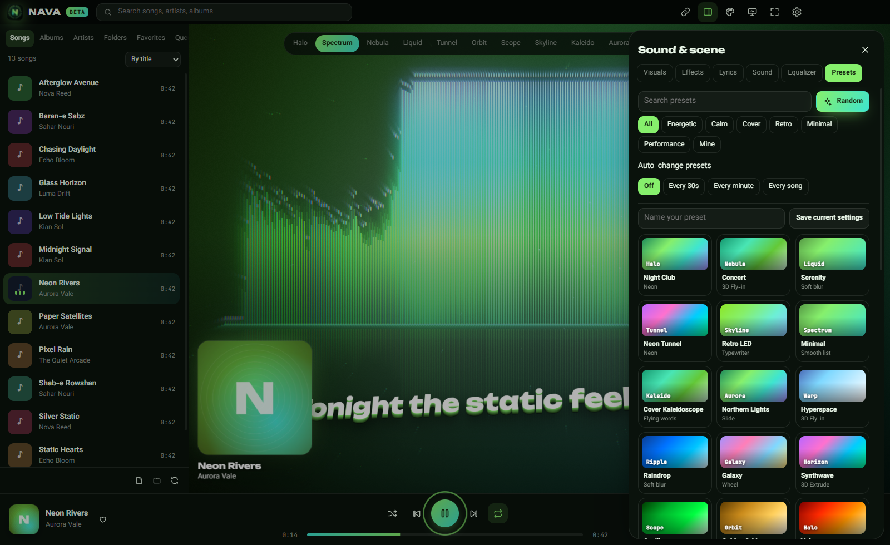</td>
</tr>
<tr>
<td align="center"><b>Sakura theme</b> & theme builder</td>
<td align="center"><b>Persian</b> interface</td>
<td align="center"><b>40 presets</b></td>
</tr>
<tr>
<td width="33%">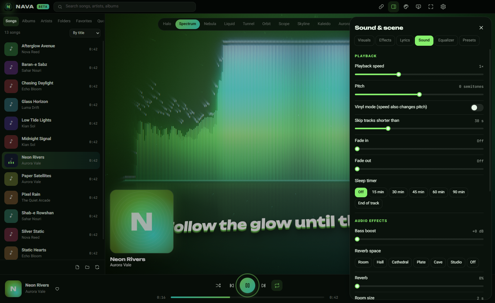</td>
<td width="33%">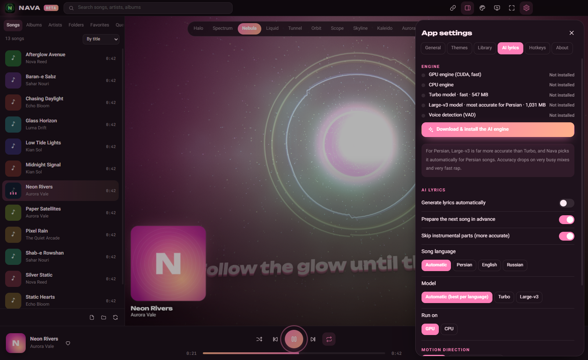</td>
<td width="33%">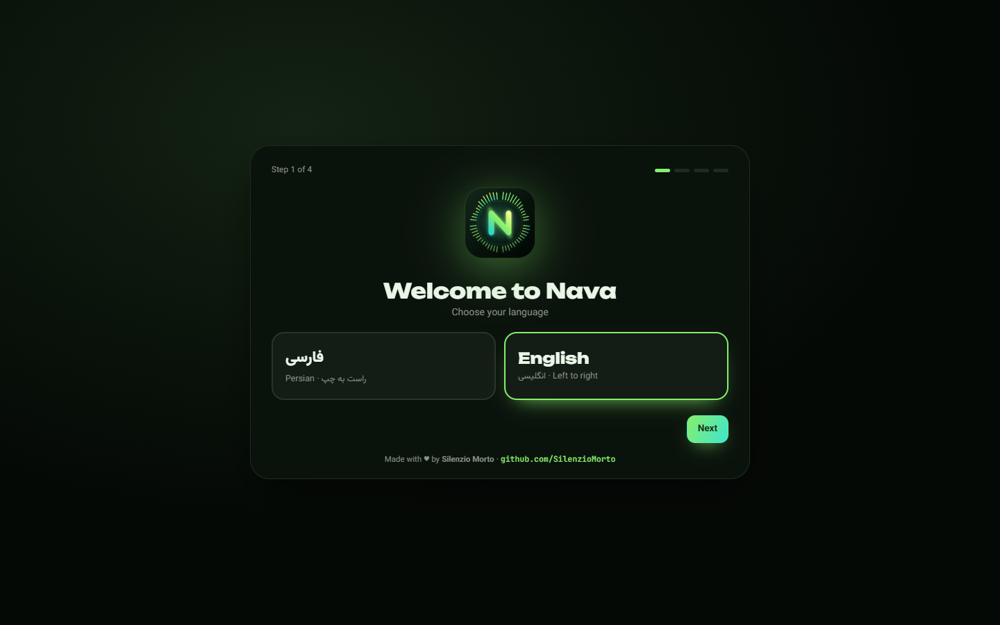</td>
</tr>
<tr>
<td align="center"><b>Sound lab</b></td>
<td align="center"><b>AI lyrics</b> settings</td>
<td align="center"><b>First-run</b> setup</td>
</tr>
</table>

## ⚙️ Every setting, explained

Nava has two settings panels: **⚙ App settings** (top bar) for the app itself, and **🎚 Sound & scene** (bottom bar) for what you see and hear.

<b>⚙ App settings → General</b>

| Setting | What it does |
|---|---|
| Language | English or Persian. Switches the whole interface instantly, including right-to-left layout. |
| When I click ✕ | *Ask me*, *Go to tray* or *Quit*. |
| Start with Windows | Launches Nava quietly in the system tray when you sign in. |
| Welcome screen on launch | A short greeting (one of 20 per language) each time Nava opens. |
| Goodbye message on exit | A short farewell (one of 20 per language) when you quit. |
| Keyboard & headset media keys | Lets play/pause/next/previous keys control Nava. |
| New-song notifications | Shows a Windows notification when a new song starts while Nava is in the background. |
| Interface animations | Turns UI transitions on or off. |

<b>⚙ App settings → Themes</b>

| Setting | What it does |
|---|---|
| Built-in themes | **Nava Lime**, **Daylight**, **Midnight**, **Sakura**, **Ember**, **Glacier**. |
| Theme builder | Choose a dark or light base, then background, panel, text, accent and second accent colours. Preview live, name it and save. Custom themes appear next to the built-in ones and can be deleted. |
| Quick switch | The palette button in the top bar (or `T`) cycles through every theme with a circular reveal animation. |

<b>⚙ App settings → Library</b>

| Setting | What it does |
|---|---|
| Scanned folders | Music, Downloads and Desktop by default. Add or remove any folder. |
| Scan all drives | Also scans every drive. Slower; system, game and plugin folders and files under 40 KB are skipped. |
| Hide short tracks | Hides tracks shorter than your skip limit from the lists. |
| Rescan / Open files / Add folder | Buttons at the bottom of the library sidebar. |

<b>⚙ App settings → AI lyrics</b>

| Setting | What it does |
|---|---|
| Engine status | Shows whether the GPU engine, CPU engine, Turbo model, Large-v3 model and voice detection are installed, with one-click download. |
| Generate lyrics automatically | Writes lyrics as soon as a song starts. |
| Prepare the next song in advance | Transcribes the next song in the queue in the background. |
| Skip instrumental parts | Uses voice detection (VAD) so silence and solos don't produce made-up text. |
| Song language | *Automatic*, *Persian*, *English* or *Russian*. Automatic also uses the song's title to guess. |
| Model | *Automatic* (Large-v3 for Persian, Turbo otherwise), *Turbo* or *Large-v3*. |
| Run on | *GPU* (CUDA) or *CPU*. |
| Where lyrics are saved | A folder of your choice (default `Documents\Nava Lyrics`) or next to each song, as `.lrc` files. |
| Save as .lrc files | Turn file export on or off (lyrics are always cached inside Nava). |
| Delete all generated lyrics | Clears the cache so songs are transcribed again. |

<b>⚙ App settings → Hotkeys & About</b>

- **Hotkeys:** 21 actions. Click one and press the new key. Conflicts are detected, and there's a reset button. Hotkeys only work while Nava is the focused window.
- **About:** version, credits, GitHub link, license, third-party notices, *Replay the tutorial* and *App data folder*.

<b>🎚 Sound & scene → Visuals</b>

| Setting | What it does |
|---|---|
| Visual mode | 16 modes: Halo, Spectrum, Nebula, Liquid, Tunnel, Orbit, Scope, Skyline, Kaleido, Aurora, Warp, Ripple, Galaxy, Horizon, Black hole, Prism. Also in the bar above the stage, or `V` / `1`–`9`. |
| Color palette | 22 palettes: Theme, Mono, Duo, Rainbow, From cover, Aurora, Sakura, Sunset, Ocean, Fire, Ice, Candy, Matrix, Gold, Vapor, Monochrome, Toxic, Ruby, Forest, Lavender, Citrus, Deep sea. |
| Bar count | 32–192 bars for bar-based visuals. |
| Audio sensitivity / Beat sensitivity | How strongly visuals react to the music and how easily kicks are detected. |
| Rotation speed | Spin speed for circular visuals. |
| Mirror | Symmetric layouts. |
| Cover in the visual / Spin cover like vinyl | Puts the album art in the centre and rotates it while playing. |
| Cover card / Cover card size | A large album-art card on the left, on the right, or hidden. |
| Frame limit / Render quality / Spectrum detail | 30, 60, 120 fps or monitor sync; render scale; FFT size 1024–4096. |
| Auto-hide controls in stage mode | Hides the cursor and mode bar after two seconds without movement. |

<b>🎚 Sound & scene → Effects</b>

Glow (bloom) · Beat flash · Motion trails · Echo zoom · Echo twist · Bass zoom · Beat shake + amount · Chromatic beat · Particle amount · Floating dust · Cover backdrop · Vignette · Film grain

<b>🎚 Sound & scene → Lyrics</b>

| Setting | What it does |
|---|---|
| Show lyrics | On/off (also `L` or the lyrics button). |
| Lyrics animation | 16 styles: Wheel, Smooth list, Karaoke, Slide, Soft blur, Word by word, Flying words, Bouncing word, Typewriter, Neon, Cinema subtitles, Page flip, 3D Extrude, 3D Fly-in, 3D Cube, 3D Orbit (`K` cycles them). |
| Position / Motion direction | Bottom, centre or top; top-to-bottom or bottom-to-top for the wheel, slide and cube. |
| Text color | Theme accent, white or gradient. |
| Text size / Sync offset / Text glow | 24–90 px; ±2 s timing correction; glow on/off. |
| Font for Persian lyrics / Font for English & Russian lyrics | Choose from built-in fonts or your own imported fonts, with a live preview. |
| Font weight | 300–900. |
| Import font files | Adds `.ttf`, `.otf`, `.woff`, `.woff2` fonts (you can also drop them onto the window). |

<b>🎚 Sound & scene → Sound</b>

| Setting | What it does |
|---|---|
| Playback speed | 0.5×–2× with the pitch kept natural. |
| Pitch | −12 to +12 semitones, independent of speed. |
| Vinyl mode | Speed changes pitch too, like a turntable. |
| Skip tracks shorter than | 0 (off) to 120 s, default 30 s. Short tracks still play when you pick them yourself. |
| Fade in / Fade out | 0–8 s and 0–12 s. |
| Sleep timer | 15, 30, 45, 60, 90 minutes or end of track; fades out gently. |
| Bass boost | Up to +15 dB. |
| Reverb | Room, Hall, Cathedral, Plate, Cave and Studio presets, plus amount, room size and damping. |
| 8D audio | Sound circles around your head; adjustable speed. |
| Balance / Stereo width / Mono | Left-right balance, 0–200% width, mono. |
| Loudness normalization | Evens out loud and quiet songs. |
| Sound booster | Up to 300% with a limiter. Asks for confirmation first, and reminds you after 10 minutes above 100%. |

<b>🎚 Sound & scene → Equalizer & Presets</b>

- **Equalizer:** on/off, 10 bands (31, 62, 125, 250, 500 Hz, 1, 2, 4, 8, 16 kHz) on a draggable curve (double-click resets a band), preamp, and 20 presets: Flat, Bass Heavy, Sub Bass, Vocal, Pop, Rock, Hip-Hop, Electronic, Club, Jazz, Classical, Acoustic, Persian Traditional, Lo-fi, Bright, Late Night, Headphones, Laptop Speakers, Loudness, Speech.
- **Presets:** search, categories (Energetic, Calm, Cover, Retro, Minimal, Performance, Mine), *Random*, auto-change (every 30 s, every minute or every song), save your own, and reset.
- **The 40 built-in presets:** Night Club · Concert · Serenity · Neon Tunnel · Retro LED · Minimal · Cover Kaleidoscope · Northern Lights · Hyperspace · Raindrop · Galaxy · Synthwave · Oscilloscope · Golden Orbit · Volcano · Frost · The Grid · Candy Pop · Ruby Rush · Misty Forest · Infinite Echo · Noir · Vinyl · Beach Sunset · Neon Mist · Light Dance · Pure Cover · Arcade · Night Ride · Molten Gold · Event Horizon · Cover Singularity · Crystal · Prism Rave · Sakura Dream · Pink Bloom · Lavender Fields · Citrus Burst · Abyss · Light & Efficient

## 📥 Installation

1. Download **`NavaPlayer-Setup-2.0.0-beta.2.exe`** from the [Releases page](../../releases).
2. Run it. If Windows SmartScreen shows *"Windows protected your PC"*, click **More info → Run anyway** (the beta isn't code-signed yet).
3. Pick your language, accept the license, choose a folder, and keep **Create Desktop Shortcut** ticked if you want one.
4. Launch Nava, choose your language and theme, and decide where AI lyrics should be saved.
5. *(Optional)* Open **Settings → AI lyrics** and click **Download & install the AI engine**.

The full step-by-step guide, including how to make Nava your default player, is in **[docs/INSTALL.md](docs/INSTALL.md)**.

### System requirements
| | Minimum | Recommended |
|---|---|---|
| OS | Windows 10 64-bit | Windows 11 64-bit |
| GPU | Any GPU with WebGL2 | NVIDIA GTX 1060 or newer (for fast AI lyrics) |
| RAM | 4 GB | 8 GB+ |
| Disk | 400 MB | 3 GB (with both AI models) |

## ⌨️ Default hotkeys

| Action | Key | Action | Key |
|---|---|---|---|
| Play / pause | `Space` | Next / previous song | `Shift` + `→` / `←` |
| Seek ±5 s | `→` / `←` | Volume | `↑` / `↓` |
| Next visual | `V` · `1`–`9` | Next palette | `C` |
| Random preset | `R` | Lyrics on/off | `L` |
| Next lyrics style | `K` | Stage mode | `H` |
| Fullscreen | `F` | Library | `B` |
| Next theme | `T` | Mute | `M` |
| Favorite | `J` | Equalizer | `E` |
| Play a link | `Ctrl` + `L` | Search | `Ctrl` + `F` |

All of them can be changed in **Settings → Hotkeys**.

## ❓ FAQ

<b>Does Nava upload my music anywhere?</b>

No. Lyrics are generated locally by whisper.cpp. The only downloads are the AI engine and models (from GitHub and Hugging Face) when you choose to install them.

<b>How accurate are the AI lyrics?</b>

Usually very good on clear vocals. Accuracy drops on very busy mixes, heavy effects and very fast rap. If the language is detected wrongly, click the <i>Lyrics ready</i> badge and choose the right language to regenerate.

<b>Why does Spotify only play 30-second previews?</b>

Log in to your Spotify account inside the embedded player to hear full tracks. Nava uses Spotify's, SoundCloud's and YouTube's official players and never downloads their content.

<b>Nava feels slow on my laptop.</b>

Open <b>Sound & scene → Presets</b> and apply <b>Light & Efficient</b> (30 fps, lower render quality, no bloom).

<b>How do I uninstall?</b>

Windows Settings → Apps → Nava Player → Uninstall. The uninstaller asks why you're leaving and can also remove your settings, lyrics cache and AI models.

## 🗺 Roadmap
- [x] GPU visual engine, 40 presets
- [x] On-device AI lyrics (Persian, English, Russian)
- [x] Installer, tray, file associations
- [ ] Signed installer and automatic updates
- [ ] Playlists and smart mixes
- [ ] Lyrics editor and manual sync
- [ ] Android version

## 💚 Support

Nava is built and maintained by one person. If you enjoy it, **a ⭐ on this repository** helps a lot — and so does sharing it with a friend.

Found a bug or have an idea? [Open an issue](../../issues/new/choose).

## 📄 License

Nava Player is **proprietary software** — it is free to use, but it is not open source. See [LICENSE](LICENSE).
Third-party components are listed in [THIRD_PARTY_NOTICES.md](THIRD_PARTY_NOTICES.md).

 
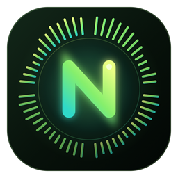
 
Made with ♥ by <a href="https://github.com/SilenzioMorto"><b>Silenzio Morto</b></a> · © 2026

